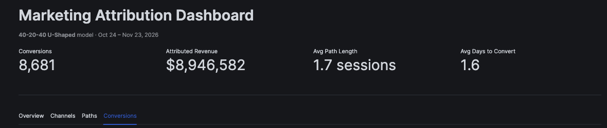
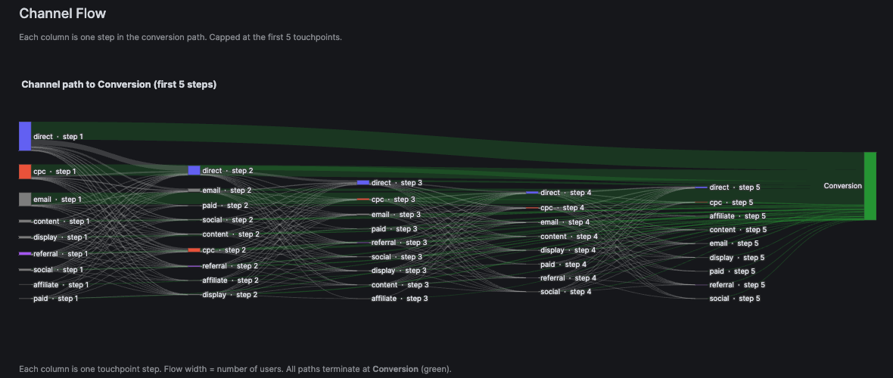

# Fullstory Marketing Attribution — Snowflake Native

A pure Snowflake-native implementation of multi-touch marketing attribution on top of Fullstory data exports. 

---

## Architecture

```
Fullstory Data Destination Tables
(raw events, users, custom_events, source_properties)
              │
              ▼
┌─────────────────────────────────────────────────────┐
│  STAGING LAYER  (Standard Views)                    │
│                                                     │
│  stg_fs__events           stg_fs__users             │
│  stg_fs__custom_events    stg_fs__source_properties │
│                                                     │
│  • Thin rename/cast layer, zero storage cost        │
│  • Date range filter driven by attribution_config   │
└─────────────────────────────────────────────────────┘
              │
              ▼
┌─────────────────────────────────────────────────────┐
│  INTERMEDIATE LAYER  (Dynamic Tables, INCR. refresh)│
│                                                     │
│  int_marketing__touchpoints                         │
│    UTM extraction, click ID detection, referrer     │
│    classification, attribution waterfall priority   │
│    dedup (one touchpoint per session)               │
│                                                     │
│  int_marketing__conversions                         │
│    Conversion event identification, lookback window │
│    tracking, conversion index per user              │
│                                                     │
│  target_lag = 'downstream' (driven by mart)         │
└─────────────────────────────────────────────────────┘
              │
              ▼
┌─────────────────────────────────────────────────────┐
│  MARTS LAYER  (Dynamic Table, INCR. refresh)        │
│                                                     │
│  fct_marketing_attribution                          │
│    Joins touchpoints → conversions with lookback    │
│    window constraints. Produces one row per         │
│    session per attribution model.                   │
│                                                     │
│  Models: First Touch · Last Touch · Linear          │
│          40-20-40 U-Shaped · Full Credit            │
│                                                     │
│  target_lag = '1 hour'  (leaf node — sets the pace) │
└─────────────────────────────────────────────────────┘

```

---

## Configuration

Runtime parameters live in a single table — no redeployment needed to change them:

```sql
SELECT * FROM fs_marketing.config.attribution_config;
```

| Column | Default | Description |
|---|---|---|
| `attribution_window_days` | `14` | Lookback window for session → conversion linking |
| `conversion_event_name` | `'Checkout Success'` | Fullstory custom event name that represents a conversion |
| `lookback_days` | 90 | Number of days of historical data to include on initialization |


## Project Structure

```
snowflake/
├── README.md                          ← you are here
├── 00_setup/
│   ├── 01_config_and_schema.sql       ← database, schemas, config table
│   └── 02_source_views.sql            ← thin views over raw Fullstory tables
├── 01_staging/
│   ├── stg_fs__events.sql
│   ├── stg_fs__users.sql
│   ├── stg_fs__custom_events.sql
│   └── stg_fs__source_properties.sql
├── 02_intermediate/
│   ├── int_marketing__touchpoints.sql  ← Dynamic Table
│   └── int_marketing__conversions.sql  ← Dynamic Table
├── 03_marts/
│   └── fct_marketing_attribution.sql  ← Dynamic Table (leaf node)
├── streamlit/                         ← optional dashboard (make dashboard)
│   ├── streamlit_app.py
│   ├── environment.yml
│   └── snowflake.yml

```

---


## Setup Instructions

### Prerequisites

- Snowflake account with:
  - A virtual warehouse (XS or S is sufficient for dev)
  - Access to your Fullstory data destination tables
  - `SYSADMIN` or equivalent role for schema creation

### Connecting via PAT

When you're ready to deploy:

1. Generate a Personal Access Token in Snowflake (Snowsight → Profile → Personal Access Tokens)
2. Configure your connection in `~/.snowflake/config.toml` or via environment variables:
   ```toml
   [connections.fs_marketing_attr]
   account   = "<your-account-identifier>"
   user      = "<your-username>"
   token     = "<your-PAT>"
   warehouse = "<your-warehouse>"
   role      = "<your-role>"
   ```
3. Use SnowSQL, the Snowflake VS Code extension, or the Python connector to execute the scripts

### Deployment Order

Run scripts in this order — each layer depends on the one above:

```bash
# 1. One-time setup (Phase 1)
01_config_and_schema.sql
02_source_views.sql

# 2. Staging views (Phase 1)
01_staging/stg_fs__events.sql
01_staging/stg_fs__users.sql
01_staging/stg_fs__custom_events.sql
01_staging/stg_fs__source_properties.sql

# 3. Intermediate Dynamic Tables  (Phase 2)
02_intermediate/int_marketing__touchpoints.sql
02_intermediate/int_marketing__conversions.sql

# 4. Mart Dynamic Table  (Phase 3)
03_marts/fct_marketing_attribution.sql
```

---

## Dashboard (optional)

A Streamlit in Snowflake app over `fct_marketing_attribution`. Pick a date range and model in the sidebar, then explore four tabs:

| Tab | What it shows |
|---|---|
| Overview | Conversions, attributed revenue, average path length, days to convert, daily revenue, revenue by source and medium |
| Channels | Top campaigns, all five models side by side by medium, source x model table |
| Paths | Most common conversion paths, path length and time-to-convert histograms, channel flow Sankey |
| Conversions | Conversion log with Session Replay links (enter your Fullstory org ID in the sidebar) |





Deploy it after Phase 3:

```bash
make dashboard
```

This creates `fs_marketing.marts.attribution_dashboard` on the warehouse runtime, using `SNOWFLAKE_WAREHOUSE` from `.env`. Open it in Snowsight under **Projects → Streamlit**.

---

## Attribution Models

### First Touch
100% of conversion credit goes to the **first** session in the user's path before conversion. Best for understanding top-of-funnel acquisition.

### Last Touch
100% of conversion credit goes to the **last** session before conversion. Best for understanding the final step that drove the decision.

### Linear
Credit is distributed **equally** across all sessions in the path. Treats every touchpoint as equally valuable.

### 40-20-40 U-Shaped
- **40%** to the first session (discovery)
- **40%** to the last session (close)
- **20%** split equally across all middle sessions
- Collapses gracefully to 50/50 for 2-session paths and 100% for single-session paths

### Full Credit
Assign 100% revenue credit to each distinct channel prior to conversion. This mirrors how some legacy systems work for posterity. 

---

## Attribution Waterfall Priority

Within a single session, if multiple traffic signals are present, one is selected using this priority order:

```
1. Paid click IDs (gclid / fbclid)     → medium = 'cpc'
2. UTM parameters (utm_source/medium)  → medium = utm_medium value
3. Known search referrers (google/bing) → medium = 'organic'
4. Other referrer domains              → medium = 'referral'
5. No signal                           → medium = 'direct'
```